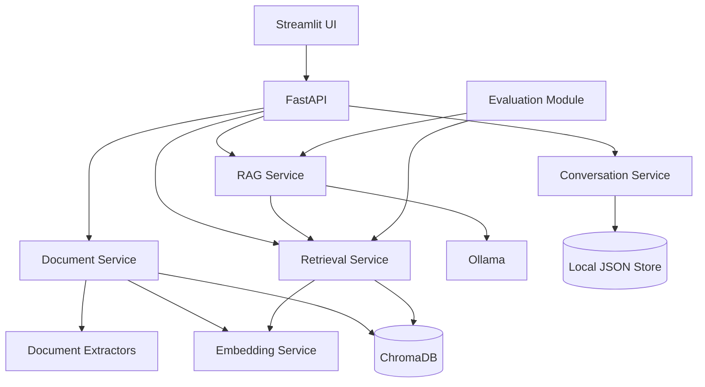

# Enterprise AI Knowledge Assistant


A local-first, modular-monolith knowledge assistant that enables users to query enterprise documents through a Retrieval-Augmented Generation (RAG) pipeline. Built with FastAPI, Ollama, Sentence Transformers, ChromaDB, and Streamlit, it combines document ingestion, semantic retrieval, grounded answer generation, and source attribution.

Users can upload PDF, DOCX, TXT, and CSV files, ask natural-language questions, and receive answers grounded in the indexed content. The application runs with a locally hosted Ollama model, keeping document processing and inference within the local environment.

## Key Features

- **Multi-format ingestion:** Supports PDF, DOCX, TXT, and CSV documents.
- **Document safeguards:** File validation, upload size limits, content hashing, metadata preservation, and duplicate prevention.
- **Configurable chunking:** Adjustable chunk size and overlap for document segmentation.
- **Semantic indexing:** Sentence Transformer embeddings stored in ChromaDB.
- **Retrieval pipeline:** Similarity-based search with configurable Top-K and similarity threshold.
- **Grounded generation:** Ollama-powered responses based on retrieved document context.
- **Source attribution:** Responses can include document names, excerpts, page numbers when available, and source references.
- **Conversation persistence:** Lightweight local JSON storage with conversation isolation.
- **Evaluation support:** Retrieval and answer-quality metrics exposed through an evaluation endpoint.
- **Developer experience:** FastAPI endpoints, an interactive Streamlit interface, Docker Compose setup, and automated tests that can run without a live LLM service.

## System Architecture

The application follows a modular-monolith design. FastAPI coordinates document processing, retrieval, RAG generation, and conversation management. The evaluation module exercises the retrieval and generation components.



### RAG Workflow

1. **Ingest:** A user uploads a supported document.
2. **Extract:** The application extracts text and preserves available document metadata.
3. **Chunk:** Extracted content is divided into configurable, overlapping chunks.
4. **Embed and index:** Sentence Transformer embeddings are generated and stored in ChromaDB.
5. **Retrieve:** A query is embedded and relevant chunks are selected using semantic similarity, Top-K, and a similarity threshold.
6. **Generate:** Retrieved context is passed to the configured Ollama model to generate an answer.
7. **Attribute:** The response includes source information to help users inspect the supporting document content.

## Technology Stack

| Area | Technologies |
|---|---|
| Language | Python 3.11+ |
| API | FastAPI |
| User interface | Streamlit |
| LLM runtime | Ollama |
| Embeddings | Sentence Transformers |
| Vector database | ChromaDB |
| Document processing | PyMuPDF, python-docx, pandas |
| Containerization | Docker, Docker Compose |
| Testing | Pytest |

## Project Structure

```text
enterprise-ai-knowledge-assistant/
├── src/app/
│   ├── api/routes/
│   ├── api/schemas/
│   ├── core/
│   ├── services/
│   ├── storage/
│   ├── evaluation/
│   └── utils/
├── frontend/
├── tests/
├── evaluation/
├── docs/
├── sample_data/
├── Dockerfile
├── docker-compose.yml
├── requirements.txt
├── .env.example
└── README.md
```

## Getting Started

### Prerequisites

- Python 3.11 or later
- [Ollama](https://ollama.com/) installed and running
- Git

### 1. Clone the repository

```bash
git clone https://github.com/reezanikeghbal-design/enterprise-ai-knowledge-assistant.git
cd enterprise-ai-knowledge-assistant
```

### 2. Create an environment and install dependencies

**Linux / macOS**

```bash
python -m venv .venv
source .venv/bin/activate
pip install -r requirements.txt
cp .env.example .env
```

**Windows (PowerShell)**

```powershell
python -m venv .venv
.venv\Scripts\Activate.ps1
pip install -r requirements.txt
copy .env.example .env
```

### 3. Pull the Ollama model

The examples below use `llama3.2:3b`. Make sure this matches the model configured in your environment:

```bash
ollama pull llama3.2:3b
```

### 4. Start the API

```bash
uvicorn app.main:app --reload
```

The interactive API documentation is available at:

- Swagger UI: http://localhost:8000/docs

### 5. Start the Streamlit interface

In a separate terminal, with the project environment activated:

```bash
streamlit run frontend/streamlit_app.py
```

## Docker Deployment

Build and start the application services:

```bash
docker compose up --build
```

Pull the model from the Ollama container:

```bash
docker compose exec ollama ollama pull llama3.2:3b
```

By default, the frontend is exposed on port `8501` and the API on port `8000`.

**Note:** Model weights are intentionally not downloaded during image builds. Pull the required model after the Ollama service is running.

## Configuration

Application settings are documented in `.env.example`. Key options include:

| Variable | Purpose |
|---|---|
| `CHUNK_SIZE` | Target size of document chunks |
| `CHUNK_OVERLAP` | Overlap between consecutive chunks |
| `TOP_K` | Maximum number of retrieved results |
| `SIMILARITY_THRESHOLD` | Minimum similarity threshold for retrieval |
| `EMBEDDING_MODEL` | Sentence Transformer model identifier |
| `OLLAMA_BASE_URL` | Ollama service endpoint |
| `OLLAMA_MODEL` | Model used for answer generation |
| `MAX_UPLOAD_SIZE_MB` | Maximum accepted upload size |

## API Reference

The application currently exposes the following endpoints:

| Method | Endpoint | Purpose |
|---|---|---|
| `POST` | `/documents/upload` | Upload and process a document |
| `GET` | `/documents` | List indexed documents |
| `DELETE` | `/documents/{document_id}` | Delete a document |
| `POST` | `/chat` | Ask a question using the RAG pipeline |
| `POST` | `/search` | Retrieve relevant document content |
| `GET` | `/conversations` | List conversations |
| `GET` | `/conversations/{id}` | Retrieve a conversation |
| `POST` | `/evaluation/run` | Run the evaluation dataset |
| `GET` | `/health` | Check application health |

### Search Example

```bash
curl -X POST http://localhost:8000/search \
  -H "Content-Type: application/json" \
  -d '{"query":"What is the refund policy?","top_k":5}'
```

## Evaluation

A manually prepared evaluation dataset is provided at `evaluation/dataset.json`. Run the evaluation through the API:

```bash
curl -X POST http://localhost:8000/evaluation/run
```

The evaluator reports computed metrics; benchmark values are not hardcoded.

The implementation includes:

- **Precision@K**
- **Recall@K**
- **Mean Reciprocal Rank (MRR)**
- **Answer relevance**
- **Faithfulness**
- **Citation accuracy**

Retrieval metrics are deterministic when expected source IDs are available. Answer relevance, faithfulness, and citation accuracy currently rely on lightweight heuristics. For high-stakes or production use, complement these results with human evaluation and a more comprehensive evaluation methodology.

## Testing

Run the automated test suite:

```bash
pytest
```

Tests use mocks and fakes where external model services would otherwise be required, allowing core application behavior to be tested without a live LLM.

## Design Considerations and Limitations

This repository is a practical engineering project and intentionally keeps several components lightweight:

- Conversation history uses local JSON persistence; it is not designed as a multi-user production database.
- ChromaDB is used as local persistent vector storage rather than a distributed vector database.
- The default answer-quality evaluator uses heuristics rather than an LLM-as-a-judge approach.
- Authentication and authorization are outside the current project scope.
- OCR is not included for image-only PDF documents.

These trade-offs keep the project approachable to run locally while making areas for further engineering work explicit.

## Future Work

Potential extensions include:

- Authentication, authorization, and tenant isolation
- Hybrid BM25 and vector retrieval
- Cross-encoder reranking
- OCR support for scanned documents
- Background processing for large ingestion workloads
- Production-grade relational persistence
- More advanced LLM-as-a-judge evaluation
- Observability, tracing, and operational metrics

## Contributing

Suggestions, issues, and contributions are welcome. Please open an issue to discuss significant changes before submitting a pull request.

## License

No license is currently specified. If you intend this project to be reused or distributed by others, consider adding an appropriate open-source license.
