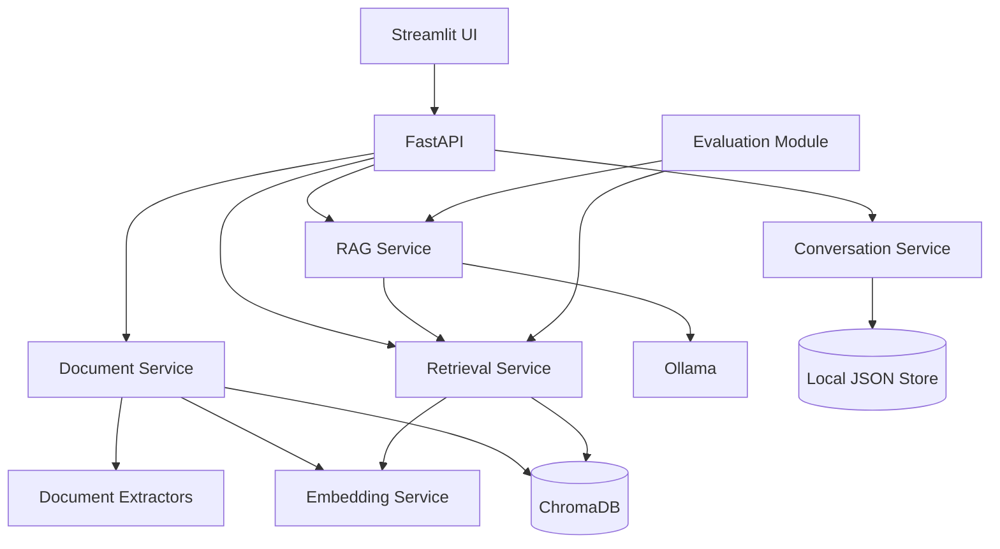

# Enterprise AI Knowledge Assistant

A lightweight modular-monolith enterprise knowledge assistant built with FastAPI, Ollama, Sentence Transformers, ChromaDB, PyMuPDF, python-docx, pandas, and Streamlit.

## Features

- PDF, DOCX, TXT, and CSV ingestion
- File validation, size limits, hashing, metadata preservation, and duplicate prevention
- Configurable chunking and overlap
- Sentence Transformer embeddings
- ChromaDB vector storage
- Semantic retrieval with similarity threshold and Top-K
- Ollama-based RAG generation
- Source citations with document name, excerpt, page when available, and source reference
- Lightweight JSON conversation persistence with conversation isolation
- Search API
- Evaluation metrics: Precision@K, Recall@K, MRR, answer relevance, faithfulness, citation accuracy
- FastAPI API
- Streamlit UI
- Docker Compose for backend, Ollama, and frontend
- Automated tests that do not require a real LLM

## Architecture



## Project structure

```text
enterprise-ai-knowledge-assistant/
├── src/app/
│   ├── api/routes/
│   ├── api/schemas/
│   ├── core/
│   ├── services/
│   ├── storage/
│   ├── evaluation/
│   └── utils/
├── frontend/
├── tests/
├── evaluation/
├── docs/
├── sample_data/
├── Dockerfile
├── docker-compose.yml
├── requirements.txt
├── .env.example
└── README.md
```

## Local setup

Python 3.11+ is recommended.

```bash
python -m venv .venv
source .venv/bin/activate
pip install -r requirements.txt
cp .env.example .env
```

Start Ollama locally and pull the configured model:

```bash
ollama pull llama3.2:3b
```

Run the API:

```bash
uvicorn app.main:app --reload
```

Run Streamlit in another terminal:

```bash
streamlit run frontend/streamlit_app.py
```

API docs are available at `/docs`.

## Docker

```bash
docker compose up --build
```

Then pull an Ollama model:

```bash
docker compose exec ollama ollama pull llama3.2:3b
```

The frontend is exposed on port 8501 and the API on port 8000.

Models are intentionally not downloaded during image builds.

## Configuration

See `.env.example`. Important settings include:

- `CHUNK_SIZE`
- `CHUNK_OVERLAP`
- `TOP_K`
- `SIMILARITY_THRESHOLD`
- `EMBEDDING_MODEL`
- `OLLAMA_BASE_URL`
- `OLLAMA_MODEL`
- `MAX_UPLOAD_SIZE_MB`

## API

- `POST /documents/upload`
- `GET /documents`
- `DELETE /documents/{document_id}`
- `POST /chat`
- `POST /search`
- `GET /conversations`
- `GET /conversations/{id}`
- `POST /evaluation/run`
- `GET /health`

Example search:

```bash
curl -X POST http://localhost:8000/search \
  -H "Content-Type: application/json" \
  -d '{"query":"What is the refund policy?","top_k":5}'
```

## Evaluation

The repository includes a small manually prepared dataset under `evaluation/dataset.json`.

Run:

```bash
curl -X POST http://localhost:8000/evaluation/run
```

The implementation reports computed metrics from the dataset. No benchmark values are hardcoded or fabricated.

Automated retrieval metrics are deterministic where expected source IDs are available. Answer relevance, faithfulness, and citation accuracy are evaluated using lightweight heuristics in the included evaluator; these should be complemented by human review for production evaluation.

## Tests

```bash
pytest
```

Tests use mocks/fakes where external model services would otherwise be required.

## Limitations

- Local JSON persistence is intentionally simple and is not a multi-user production database.
- ChromaDB is local persistent storage rather than a distributed vector service.
- The default evaluator uses lightweight heuristics, not a judge LLM.
- Authentication and authorization are outside this portfolio scope.
- OCR is not included for image-only PDFs.

## Future improvements

- Authentication and tenant isolation
- Hybrid BM25 + vector retrieval
- Cross-encoder reranking
- OCR pipeline
- Background ingestion for very large files
- Production relational persistence
- Advanced LLM-as-judge evaluation
- Observability and tracing
